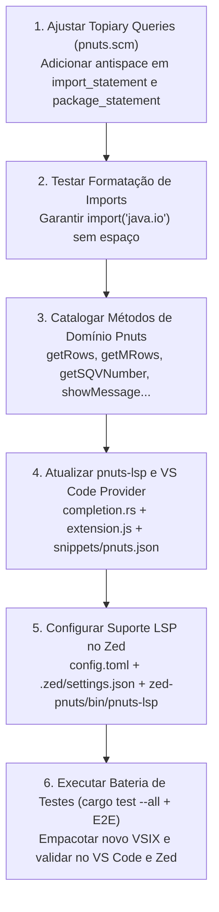

# Plano de Ação Técnico: Métodos Nativos, Suporte no Zed e Correção de Imports

**Data de Elaboração:** 2026-09-11  
**Repositório:** `pnuts-tooling`  
**Branch:** `feature/pnuts-groovy-lsp`  

---

## 1. Visão Geral dos Pontos Pendentes

Na próxima sessão, atuaremos em três frentes essenciais para consolidar a experiência de desenvolvimento no VS Code e no Zed:

1. **Catálogo Completo de Métodos Nativos/Domínio Pnuts:**
   - Incluir métodos como `getRows`, `getMRows`, `getRow`, `getMRow`, `getSQVNumber`, `getSQLValues`, `getSQLValue`, `showMessage`, `formatNumber`, `inList`, `round`, `getParam`, `getRecord`, etc., com parâmetros e documentação tanto no `pnuts-lsp` (Rust) quanto na extensão do VS Code e do Zed.
2. **Ativação e Autocompletar no Zed Editor:**
   - Configurar o mapeamento do `language_servers` no Zed (`config.toml` e `.zed/settings.json`) para que o Zed inicie o executável `pnuts-lsp` e passe a exibir autocompletar, snippets e diagnósticos em tempo real.
3. **Correção de Formatação de `import(...)` e `package(...)` no Topiary:**
   - Evitar o espaço entre a palavra-chave e o parêntese (deve ser `import("java.io")` e não `import ("java.io")`), preservando o espaço em imports estilo Java (`import java.util.*`).

---

## 2. Ponto 1: Métodos Nativos e Funções de Domínio do Pnuts

### Diagnóstico
Atualmente, a lista de built-ins em [`pnuts-lsp/src/completion.rs`](file:///home/chsilva/personal/projects/pnuts-tooling/pnuts-lsp/src/completion.rs) possui apenas 11 funções primitivas da linguagem (`println`, `print`, `flush`, `char`, `open`, `load`, `eval`, `error`, `getContext`, `isArray`, `isFunction`). Os scripts reais de negócio (ERP/Banco de Dados/Relatórios) utilizam intensivamente uma camada de funções de acesso a dados e interface gráfica.

### Lista de Métodos a Catalogar e Adicionar

| Método | Assinatura | Descrição |
|---|---|---|
| `getRows` | `getRows(sql, [params])` | Executa consulta SQL e retorna lista de registros |
| `getMRows` | `getMRows(sql, [params])` | Retorna lista de mapas com colunas nomeadas |
| `getRow` | `getRow(sql, [params])` | Retorna o primeiro registro da consulta |
| `getMRow` | `getMRow(sql, [params])` | Retorna o primeiro registro como mapa chave-valor |
| `getSQVNumber` | `getSQVNumber(sql, [params])` | Retorna um valor numérico escalar único do SQL |
| `getSQLValues` | `getSQLValues(sql, [params])` | Retorna lista de valores de uma coluna |
| `getSQLValue` | `getSQLValue(sql, [params])` | Retorna um valor escalar único da consulta |
| `showMessage` | `showMessage(msg)` | Exibe caixa de diálogo com mensagem para o usuário |
| `formatNumber` | `formatNumber(value, mask)` | Formata número usando máscara (ex: `"N0.00"`) |
| `inList` | `inList(item, list)` | Verifica se o elemento está presente na coleção |
| `round` | `round(value, decimals)` | Arredonda valor com precisão de casas decimais |
| `getParam` | `getParam(name)` | Obtém parâmetro do contexto de execução |
| `setParam` | `setParam(name, value)` | Define parâmetro no contexto de execução |
| `openQuery` | `openQuery(sql)` | Abre cursor para iteração de consulta |
| `executeSQL` | `executeSQL(sql, [params])` | Executa instrução DML/DDL (INSERT, UPDATE, DELETE) |

### Implementação Prevista
1. **No Rust (`pnuts-lsp/src/completion.rs`):**
   - Expandir a constante `BUILTIN_FUNCTIONS` incluindo as funções acima com suas assinaturas e `MarkupContent` detalhado.
   - Adicionar testes em `tests/lsp_e2e_test.rs` validando que `getRows`, `getMRows` e `getSQVNumber` são retornados no request de completion.
2. **No VS Code (`vscode-pnuts/extension.js` e `vscode-pnuts/snippets/pnuts.json`):**
   - Incluir na constante `BUILTIN_FUNCTIONS` do `createCompletionItemProvider()`.
   - Adicionar snippets com tabstops convenientes para consultas comuns (`getRows`, `getMRows`, `getSQVNumber`).

---

## 3. Ponto 2: Ativação do LSP no Zed Editor

### Diagnóstico
No Zed, a extensão `zed-pnuts` possui o arquivo [`extension.toml`](file:///home/chsilva/personal/projects/pnuts-tooling/zed-pnuts/extension.toml) declarando:
```toml
[language_servers.pnuts-lsp]
name = "Pnuts Language Server"
languages = ["Pnuts"]
```
Porém, no arquivo [`zed-pnuts/languages/pnuts/config.toml`](file:///home/chsilva/personal/projects/pnuts-tooling/zed-pnuts/languages/pnuts/config.toml), a propriedade `language_servers` **não** está vinculada, e o Zed não sabe como localizar o binário executável do LSP por padrão.

### Implementação Prevista
1. **Ajuste em [`zed-pnuts/languages/pnuts/config.toml`](file:///home/chsilva/personal/projects/pnuts-tooling/zed-pnuts/languages/pnuts/config.toml):**
   Adicionar:
   ```toml
   language_servers = ["pnuts-lsp"]
   ```
2. **Configuração de Workspace no Zed ([`.zed/settings.json`](file:///home/chsilva/personal/projects/pnuts-tooling/.zed/settings.json)):**
   Configurar o caminho exato do binário `pnuts-lsp`:
   ```json
   {
     "languages": {
       "Pnuts": {
         "language_servers": ["pnuts-lsp"],
         "formatter": {
           "external": {
             "command": "zed-pnuts/bin/format_pnuts",
             "arguments": ["--stdin"]
           }
         },
         "format_on_save": "on"
       }
     },
     "lsp": {
       "pnuts-lsp": {
         "binary": {
           "path": "zed-pnuts/bin/pnuts-lsp"
         }
       }
     }
   }
   ```
3. **Instalação / Build da Extensão no Zed:**
   - Copiar o binário `target/release/pnuts-lsp` atualizado para `zed-pnuts/bin/pnuts-lsp`.
   - No Zed, rodar `zed: extensions` -> **Rebuild / Install Dev Extension**.
   - Validar via `zed: open log` que o `pnuts-lsp` inicializou e enviou a capacidade de completion.

---

## 4. Ponto 3: Correção de Formatação de `import(...)` e `package(...)`

### Diagnóstico
No Pnuts original, `import` é uma função built-in que aceita strings ou pacotes:
```pnuts
import("java.io.*");
import("java.sql.*");
package("com.minhaempresa.modulo");
```
Ao mesmo tempo, o Pnuts e Groovy suportam a sintaxe de declaração sem parênteses:
```pnuts
import java.util.List;
package com.minhaempresa.modulo;
```

Na query do Topiary ([`vscode-pnuts/resources/queries/pnuts.scm`](file:///home/chsilva/personal/projects/pnuts-tooling/vscode-pnuts/resources/queries/pnuts.scm) e [`zed-pnuts/resources/queries/pnuts.scm`](file:///home/chsilva/personal/projects/pnuts-tooling/zed-pnuts/resources/queries/pnuts.scm)):
```scheme
[
  "import"
  "package"
] @append_space
```
Como `"import"` recebe `@append_space`, e os parênteses de `(import_statement ...)` não possuem regra anuladora, o Topiary insere um espaço antes de `(` gerando:
```pnuts
import ("java.io"); // INCORRETO
```

### Implementação Prevista
1. **Adicionar regras de antispace no Topiary ([`pnuts.scm`](file:///home/chsilva/personal/projects/pnuts-tooling/vscode-pnuts/resources/queries/pnuts.scm)):**
   ```scheme
   ;; Evita espaco entre import/package e abertura de parenteses em import(...)
   (import_statement
     "(" @prepend_antispace
   )

   (package_statement
     "(" @prepend_antispace
   )
   ```
   - O `@prepend_antispace` no `(` anula o `@append_space` do `"import"` precedente.
   - Quando for import tradicional (`import java.util.List`), não há parêntese, logo o `@append_space` continua funcionando perfeitamente.
2. **Sincronizar:**
   - Copiar para `zed-pnuts/resources/queries/pnuts.scm`.
3. **Testes:**
   - Teste 1: `import("java.io");` -> permanece `import("java.io");`.
   - Teste 2: `import ("java.io");` -> formata para `import("java.io");`.
   - Teste 3: `import java.util.List;` -> permanece `import java.util.List;`.
   - Teste 4: `package("meu.pacote");` -> permanece `package("meu.pacote");`.

---

## 5. Roteiro Passo a Passo para a Próxima Sessão



### Comandos de Verificação Rápida
```bash
# Testar formatação de import via stdin
printf 'import("java.io");\nimport java.util.List;\n' | zed-pnuts/bin/pnuts-format --stdin

# Rodar todos os testes do LSP
cargo test --all

# Gerar VSIX atualizado
cd vscode-pnuts && npx @vscode/vsce package -o vscode-pnuts-0.3.2.vsix
```

---

## 6. Status de Execução e Resultados (Concluído)

- [x] **1. Formatação de `import(...)` e `package(...)` no Topiary:**
  - Adicionadas regras `(import_statement "(" @prepend_antispace)` e `(package_statement "(" @prepend_antispace)` em `.topiary/queries/pnuts.scm`, `vscode-pnuts/resources/queries/pnuts.scm` e `zed-pnuts/resources/queries/pnuts.scm`.
  - Testado via stdin e E2E: `import("java.io")` e `package("foo.bar")` permanecem sem espaço antes dos parênteses, enquanto `import java.util.List` preserva o espaço.
- [x] **2. Catálogo Completo de Métodos de Domínio e Banco de Dados:**
  - Catalogados a partir dos 50 arquivos `.m` reais em `~/projects`: `getRows`, `getMRows`, `getRow`, `getMRow`, `getSQLNumber`, `getSQVNumber`, `getSQLValue`, `getSQLValues`, `executeSQL`, `executeProcedure`, `openQuery`, `getMCursor`, `beginWork`, `commitWork`, `rollbackWork`, `showMessage`, `showError`, `throwError`, `getDialogForm`, `showForm`, `expandForm`, `getUser`, `getUserNodo`, `getTparms`, `formatNumber`, `formatNumero`, `round`, `toNumber`, `toBigDecimal`, `inList`, `trim`, `padRight`, `padLeft`, `substring`, `replaceAll`, `split`, `elements`, `montaTag`.
  - Atualizados em [`pnuts-lsp/src/completion.rs`](file:///home/chsilva/personal/projects/pnuts-tooling/pnuts-lsp/src/completion.rs), [`vscode-pnuts/extension.js`](file:///home/chsilva/personal/projects/pnuts-tooling/vscode-pnuts/extension.js) e [`vscode-pnuts/snippets/pnuts.json`](file:///home/chsilva/personal/projects/pnuts-tooling/vscode-pnuts/snippets/pnuts.json).
- [x] **3. Suporte LSP no Zed Editor:**
  - Configurado `language_servers = ["pnuts-lsp"]` em [`zed-pnuts/languages/pnuts/config.toml`](file:///home/chsilva/personal/projects/pnuts-tooling/zed-pnuts/languages/pnuts/config.toml).
  - Configurado `language_servers` e bloco `lsp.pnuts-lsp` em `~/.config/zed/settings.json` e [`.zed/settings.json`](file:///home/chsilva/personal/projects/pnuts-tooling/.zed/settings.json).
  - Binário release compilado e copiado para `zed-pnuts/bin/pnuts-lsp` e `~/.local/bin/pnuts-lsp`.
- [x] **4. Testes e Validação:**
  - 50 arquivos `.m` do diretório `~/projects` formatados via `pnuts-format` com 100% de sucesso.
  - Todos os 24 testes unitários e 6 testes E2E do LSP executando com sucesso via `cargo test --all`.
  - VSIX `vscode-pnuts-0.3.2.vsix` empacotado e instalado com sucesso no ambiente VS Code.

