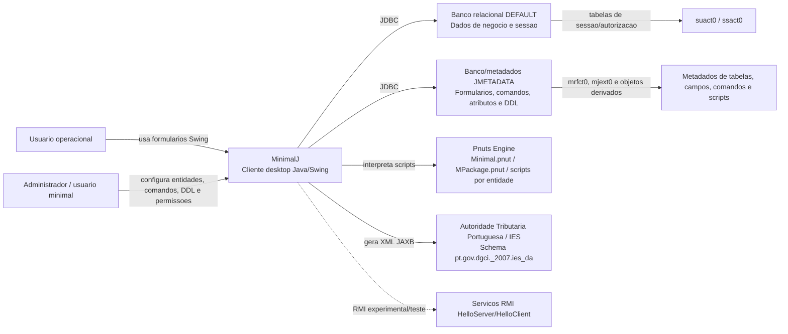
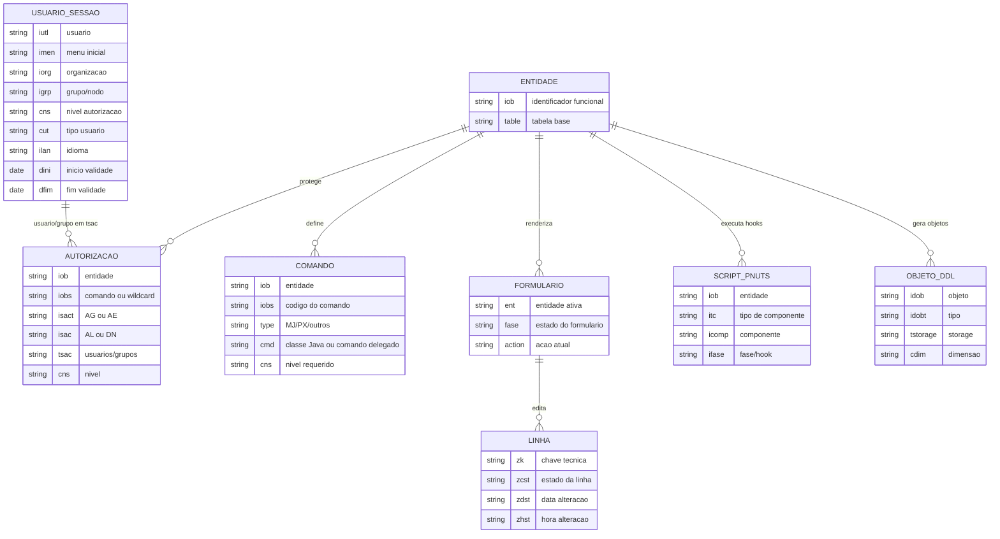

# Arquitetura — MinimalJ

## Sumario Executivo

O MinimalJ e um framework desktop legado em Java/Swing para operar formularios, comandos, metadados de banco, regras dinamicas Pnuts e rotinas administrativas/fiscais. A arquitetura e centrada em um cliente rico que abre conexoes JDBC diretas para bancos relacionais corporativos e usa metadados para descobrir telas, autorizacoes, comandos e scripts em tempo de execucao.

Confianca geral: 🟢 **CONFIRMADO** para a topologia Java/Swing + JDBC + Pnuts; 🟡 **INFERIDO** para limites exatos entre banco de metadados e banco de dados de negocio, porque nao ha DDL ou dump das tabelas de producao no workspace.

## Drivers Arquiteturais

| Driver | Impacto | Confianca |
|--------|---------|-----------|
| Aplicacao desktop Swing/AWT, com `MinMain` como entrada principal. | O runtime esperado e uma JVM com UI local e classpath contendo drivers JDBC e Pnuts. | 🟢 CONFIRMADO |
| Persistencia direta via JDBC para Oracle, Informix, PostgreSQL, SQL Server e ODBC. | A aplicacao desktop conhece DSNs, usuarios, senhas e dialetos de banco. | 🟢 CONFIRMADO |
| Comandos definidos por metadados e executados por reflexao. | A politica de comandos vive fora do codigo compilado e depende de registros/configuracoes corretos. | 🟢 CONFIRMADO |
| Regras Pnuts carregadas dinamicamente. | Validacoes e comportamento de formularios podem mudar sem recompilar Java. | 🟢 CONFIRMADO |
| Ausencia de testes automatizados. | A validacao de mudancas depende de testes manuais de GUI, banco e scripts. | 🟢 CONFIRMADO |

## Visao C4 — Contexto

## Containers Logicos

| Container | Responsabilidade | Tecnologia | Evidencia | Confianca |
|-----------|------------------|------------|-----------|-----------|
| Cliente MinimalJ | Inicializa login, menu, formularios, comandos, editor e fluxos CRUD. | Java SE, Swing/AWT | `PT/Minimal/geral/MinMain.java`, `MFrame`, `MForm`, `MMenu` | 🟢 CONFIRMADO |
| Motor de comandos | Resolve comando por entidade, valida autorizacao e instancia executor via reflexao. | Java, `Class.forName`, `MExternalCommand` | `PT/Minimal/actions/MHandleCommand.java` | 🟢 CONFIRMADO |
| Motor de persistencia | Mantem conexoes, cursores, transacoes, SQL direto/preparado e operacoes de linha. | JDBC, `MConnection`, `MCursor`, `MRow` | `PT/Minimal/geral/MConnection.java`, `MRow.java` | 🟢 CONFIRMADO |
| Motor Pnuts | Carrega pacotes, globais e hooks de formulario/linha/comando. | Pnuts | `PT/Minimal/pnuts/MPnuts.java`, `Minimal.pnut` | 🟢 CONFIRMADO |
| Banco DEFAULT | Armazena sessao, autorizacao e dados operacionais acessados pela aplicacao. | Oracle/Informix/PostgreSQL/SQL Server/ODBC | `MLogin.doDefaultConnection`, `MCheckAut.loadAut` | 🟢 CONFIRMADO |
| Banco JMETADATA | Armazena metadados para formularios, atributos, comandos e geracao de DDL. | Banco relacional via JDBC | `MGerDDLOra.get0tableDDL`, referencias a `mrfct0` | 🟡 INFERIDO |
| Servicos RMI | Demonstra comunicacao remota simples. | Java RMI | `PT/Minimal/rmi/HelloServer.java`, `HelloClient.java` | 🟢 CONFIRMADO |

## Fluxo Principal de Execucao

1. `MinMain` carrega propriedades e chama o login.
2. `MLogin` abre conexoes de metadados e DEFAULT, consulta `suact0` e popula usuario, grupo, organizacao, menu, nivel, tipo e idioma.
3. A interface Swing mostra menus e formularios baseados em entidade.
4. Um evento de UI chega a `MHandleCommand` como string de comando.
5. `MHandleCommand` localiza `MCommand`, chama `MCheckAut.checkAut` e instancia a classe executora via reflexao.
6. Comandos CRUD usam `MInsert`, `MUpdate`, `MDelete` e `MRow` para validar formulario, executar hooks Pnuts e aplicar SQL.
7. `MConnection` e `MCursor` executam SQL em bancos multi-dialeto, com batch/commit/rollback nos comandos de escrita.

## Modelo de Dados Arquitetural

Nao ha DDL completo no repositorio. O ERD abaixo representa o metamodelo confirmado/inferido pelo codigo, nao o schema fisico final de uma instalacao.

## Integracoes Externas

| Integracao | Protocolo/Formato | Direcao | Observacao | Confianca |
|------------|-------------------|---------|------------|-----------|
| Oracle Database | JDBC Thin | MinimalJ -> Banco | Driver `oracle.jdbc.driver.OracleDriver` registrado em `MConnection`. | 🟢 CONFIRMADO |
| IBM Informix | JDBC | MinimalJ -> Banco | Driver `com.informix.jdbc.IfxDriver`; ha URLs Informix hardcoded em alguns comandos. | 🟢 CONFIRMADO |
| PostgreSQL | JDBC | MinimalJ -> Banco | Driver `org.postgresql.Driver` e tratamento de `PSQLException`. | 🟢 CONFIRMADO |
| SQL Server | JDBC | MinimalJ -> Banco | Classes de drivers Microsoft antigas e novas aparecem em `MConnection`. | 🟢 CONFIRMADO |
| ODBC | JDBC-ODBC Bridge | MinimalJ -> Fonte ODBC | Usa `sun.jdbc.odbc.JdbcOdbcDriver`, removido do Java 8. | 🟢 CONFIRMADO |
| Pnuts | Interprete local | MinimalJ -> Scripts | Scripts de validacao e expansao carregados em runtime. | 🟢 CONFIRMADO |
| IES/DGCI/AT Portugal | XML/JAXB | MinimalJ -> XML fiscal | Evidencia em `Mies.java`; usuario confirmou que nao e feature obrigatoria do sistema novo. | 🟢 CONFIRMADO |
| Java RMI | RMI | Cliente <-> Servidor | Apenas classes `Hello*`; usuario confirmou que nao era requisito produtivo a preservar. | 🟢 CONFIRMADO |

## Dividas Tecnicas e Riscos

| Risco | Severidade | Evidencia | Impacto | Confianca |
|-------|------------|-----------|---------|-----------|
| Dependencia de `sun.jdbc.odbc.JdbcOdbcDriver`. | Alta | `MConnection.java` | Bloqueia runtime moderno em Java 8+ sem substituicao. | 🟢 CONFIRMADO |
| Drivers de banco nao versionados no repositorio. | Alta | ausencia de gerenciador de dependencias | Build/runtime nao reprodutivel. | 🟢 CONFIRMADO |
| SQL concatenado com valores de metadados/entrada. | Alta | `MCheckAut.loadAut`, geradores DDL, consultas diversas | Risco de injecao ou quebra por escaping em instalacoes reais. | 🟢 CONFIRMADO |
| Comandos por reflexao baseados em metadados. | Media | `MHandleCommand.Class.forName` | Falhas de runtime se metadados e classpath divergirem. | 🟢 CONFIRMADO |
| Estado global estatico de login, conexoes e Pnuts. | Media | `MLogin`, `MConnection`, `MPnuts` | Dificulta testes, concorrencia e isolamento de sessoes. | 🟢 CONFIRMADO |
| Regras espalhadas entre Java, banco e Pnuts. | Alta | `MRow.doPnut`, `Minimal.pnut`, metadados ausentes | Especificacao comportamental depende de dump de metadados. | 🟢 CONFIRMADO |
| Ausencia de testes automatizados. | Alta | inventario do Scout | Regressao so pode ser detectada por execucao manual ampla. | 🟢 CONFIRMADO |
| URLs/ambientes Informix hardcoded. | Media | `MJEX0`, `MCopyRows`, `SDOB0`, `MLoginBatch` | Migração de ambiente exige busca e limpeza manual. | 🟢 CONFIRMADO |

## Lacunas Arquiteturais

| Lacuna | Por que importa | Proxima evidencia necessaria |
|--------|-----------------|------------------------------|
| DDL completo de `suact0`, `ssact0`, `mrfct0`, `mjext0` e demais tabelas de metadados. | Fecha cardinalidades, chaves e politica real de autorizacao/comandos. | Dump DDL ou acesso read-only ao banco de metadados. |
| Lista real de comandos cadastrados por entidade. | Permite construir uma matriz completa de telas, comandos e classes executoras. | Export de metadados de comandos. |
| Scripts Pnuts por entidade em producao. | O comportamento completo de formulario/linha pode estar fora dos tres `.pnut` versionados. | Pasta/classpath completo de scripts. |
| Versoes dos drivers JDBC e Pnuts. | Necessario para reproduzir build e runtime. | Classpath original, libs ou manifesto de distribuicao. |
