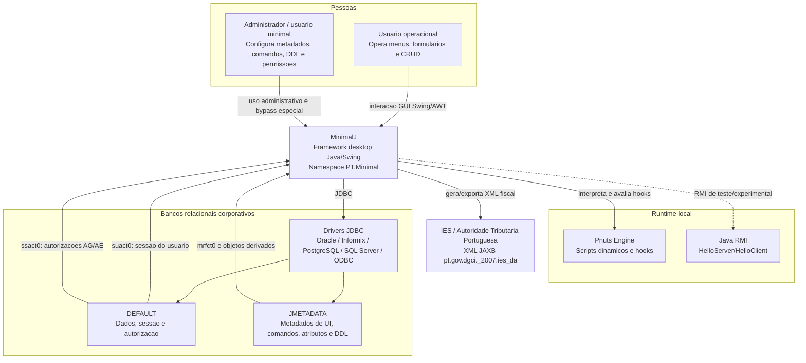

# C4 Contexto — MinimalJ

Este diagrama descreve o MinimalJ no nivel de contexto: quem usa o sistema, quais sistemas externos participam e quais protocolos foram identificados.

## Relacionamentos

| Origem | Destino | Relacao | Confianca |
|--------|---------|---------|-----------|
| Usuario operacional | MinimalJ | Usa telas Swing e dispara comandos por menus/botoes. | 🟢 CONFIRMADO |
| Administrador / `minimal` | MinimalJ | Opera configuracoes e bypass de autorizacao normal. | 🟢 CONFIRMADO |
| MinimalJ | Bancos relacionais | Usa JDBC direto para conexao, transacao, SQL, metadados e DDL. | 🟢 CONFIRMADO |
| MinimalJ | Pnuts | Carrega `init.pnut`, `Minimal.pnut`, `MPackage.pnut` e avalia hooks. | 🟢 CONFIRMADO |
| MinimalJ | IES / AT Portugal | Usa JAXB para estruturas de declaracao IES. | 🟡 INFERIDO |
| MinimalJ | Java RMI | Contem cliente/servidor de exemplo ou infraestrutura rudimentar. | 🟡 INFERIDO |

