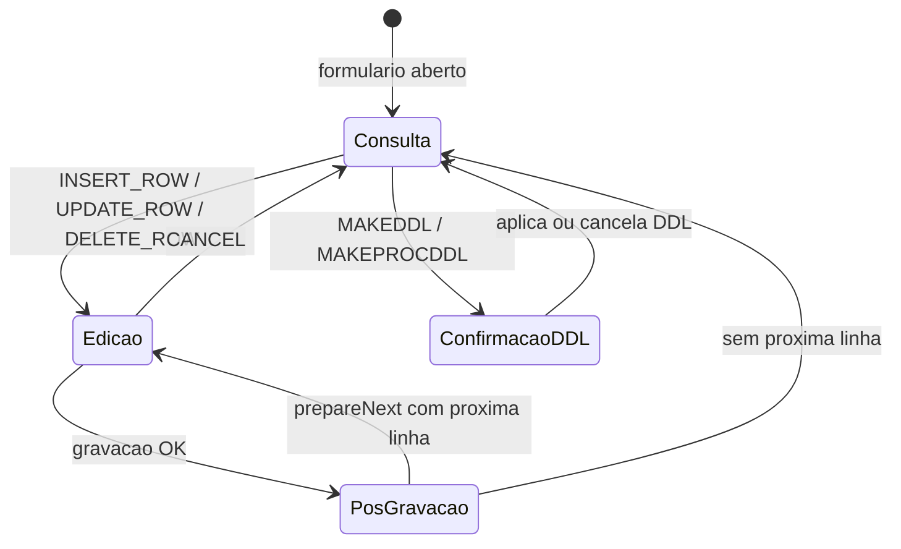
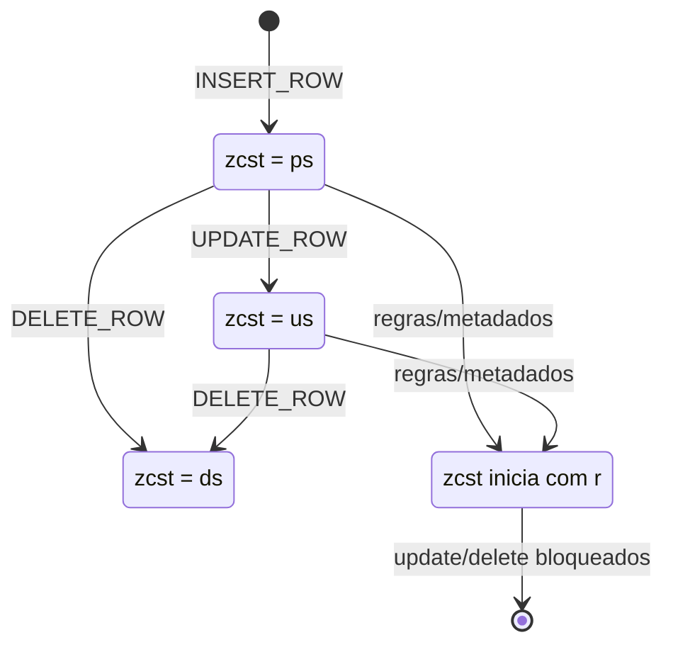
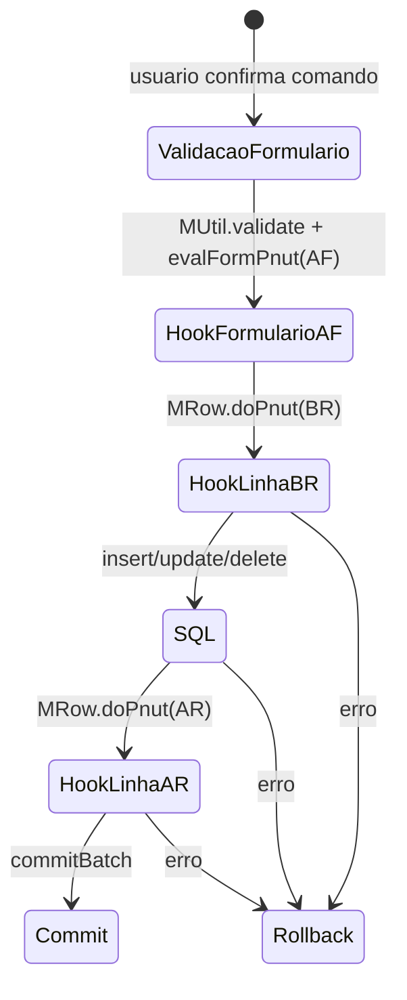

# Maquinas de Estado — MinimalJ

## Visao Geral

O MinimalJ usa estados pequenos e distribuidos em vez de uma unica maquina central. As maquinas mais relevantes sao: fase do formulario (`MForm.fase`), ciclo da linha (`zcst`) e hooks Pnuts por fase (`BF`, `AF`, `BR`, `AR`, etc.).

## 1. Fase de Formulario CRUD (`MForm.fase`)

| Estado | Significado | Gatilhos observados | Confianca |
|--------|-------------|---------------------|-----------|
| `0` | Consulta/inicio: comando ainda vai abrir tela de edicao. | `INSERT_ROW`, `UPDATE_ROW`, `DELETE_ROW` em comandos de UI. | 🟢 CONFIRMADO |
| `1` | Edicao/confirmacao: formulario de manutencao aberto e pronto para gravar. | `show_insert_row`, `show_update_row`, `show_delete_row`. | 🟢 CONFIRMADO |
| `2` | Pos-gravacao/proximo registro em lote. | `do_insert_row` e `do_update_row` chamam `setFase(2)` e `prepareNext`. | 🟢 CONFIRMADO |
| `101` | Fase especial para confirmar/aplicar DDL em entidades administrativas. | `STAB0` e `SPRO0` testam `getFase() == 101`. | 🟢 CONFIRMADO |

## 2. Ciclo de Estado da Linha (`zcst`)

| Valor/padrao | Significado observado | Origem | Confianca |
|--------------|-----------------------|--------|-----------|
| `ps` | Linha inserida/preparada pelo fluxo de insert. | `MInsert.do_insert_row`, `MRow.insertRow`. | 🟢 CONFIRMADO |
| `us` | Linha alterada pelo fluxo de update. | `MUpdate.do_update_row`. | 🟢 CONFIRMADO |
| `ds` | Linha excluida pelo fluxo de delete apos refresh. | `MRow.deleteRow`. | 🟢 CONFIRMADO |
| prefixo `r` | Linha restrita/read-only para update/delete em certos saltos e preparacoes. | `MDelete.prepareNext`, `MinSaltoME`. | 🟢 CONFIRMADO |
| outros codigos | Possiveis codigos definidos em metadados ou banco. | Nao centralizados no codigo. | 🔴 LACUNA |

## 3. Hooks de Regra Pnuts e Banco

| Fase | Momento | Evidencia | Confianca |
|------|---------|-----------|-----------|
| `BF` | Antes de fluxo/formulario ou antes de comando Z quando configurado. | `MDelete`, `MCallProcZ`, `MPnuts.evalFormPnut`. | 🟢 CONFIRMADO |
| `AF` | Depois de validacao/formulario e antes/depois de gravacao, conforme comando. | `MInsert`, `MUpdate`, `MDelete`, `MStatusChanger`. | 🟢 CONFIRMADO |
| `BR` | Antes da operacao SQL na linha. | `MRow.insertRow`, `updateRow`, `deleteRow`. | 🟢 CONFIRMADO |
| `AR` | Depois da operacao SQL na linha. | `MRow.insertRow`, `updateRow`, `deleteRow`. | 🟢 CONFIRMADO |
| `BC`, `BA`, `AA`, `AC` | Antes/depois de mudancas de status em lote. | `MStatusChanger`. | 🟢 CONFIRMADO |
| `RI`, `RU`, `RD` | Fases de trigger/procedure geradas para insert, update e delete no banco. | `MGerDDLOra`, `MGerDDLSql`, `MGerDDLInf`. | 🟢 CONFIRMADO |

## Lacunas

| Lacuna | Impacto | Confianca |
|--------|---------|-----------|
| Catalogo completo de fases (`ifase`) cadastradas em `mjext0`/metadados nao esta no repositorio. | A maquina real de scripts pode ter mais fases que as detectadas no codigo Java. | 🔴 LACUNA |
| Sem dump dos metadados, nao e possivel listar todas as transicoes de `MStatusChanger`. | Os argumentos do comando definem origem/destino/falha em runtime. | 🔴 LACUNA |
